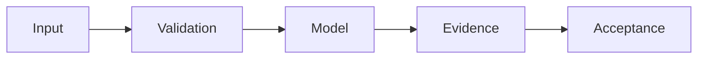

# Recursive Collateral Money System — SCIENTIFIC DOSSIER V5

**Дата:** 24.10.2026. **Статус:** SIMULATION / EVM LAB.

> Научно-технический source audit. Наличие кода, документации, тестов или workflow не означает фактического запуска, подтверждённой доходности или production readiness.

## Проблема и метод

Модель поддерживаемой продуктивной ликвидности при резервных ограничениях.

## Проверенные исходники

- [model/simulate.py](../model/simulate.py)
- [test/System.t.sol](../test/System.t.sol)

## Формализация и проверка

Общее требование: отчёты должны связывать claim с commit SHA, данными, тестовыми параметрами и наблюдаемым raw output. 

**Acceptance:** Проверка рекурсии q=cf·reuse·0.25<1, HF shock, отдельный HardNAV.

## Ограничения и отрицательные результаты

Показатель productive liquidity ≠ созданная внешняя стоимость.

## Дальнейший инженерный план

1. Проверить версии зависимостей и воспроизводимость команд тестирования.
2. Добавить negative/adversarial controls, документировать failed-case.
3. Зафиксировать фактический CI verdict и привязанный SHA; не повышать зрелость из одного факта существования workflow.
4. Поддерживать границу между R&D, CANDIDATE и DEPLOYED.

Оформление по научному профилю [dlp_solver](https://github.com/Shtenco/dlp_solver) и [synergy_system](https://github.com/Shtenco/synergy_system). Исходный README сохранён.
